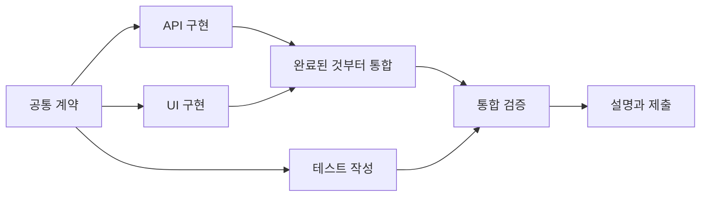

# 3시간 작업의 속도와 병렬화

전체 소요 시간은 핵심 의존 경로, 설정·대기, 통합, 검증과 이해 시간을 합쳐 판단한다. 독립 작업은 겹쳐 진행하고 공통 계약과 최종 통합처럼 필요한 직렬 구간은 짧고 명확하게 만든다. 아래 시간은 운영 제안이며 시험의 배점이나 실측 성능이 아니다.

## 반복 요청을 파일로 옮기기

| 위치 | 넣을 내용 | 갱신 주체 |
| --- | --- | --- |
| AGENTS.md | 매번 유지할 작업·검증·위임 원칙과 실제 실행 명령 | 주 에이전트 |
| WORKLOG.md | 이번 요구·완료 조건·현재 상태·결정·검증·다음 행동 | 주 에이전트 |
| CONTRACT.md | 병렬 구현에 필요한 함수/API·데이터·오류 정책 | 계약 담당 한 명 |
| Skill | 반복할 가치가 있는 특정 절차와 도메인 검사 | 필요할 때 담당자 |
| 짧은 요청 | 이번 작업 ID와 바뀐 목표·범위·시간 | 사용자 |

AGENTS와 WORKLOG로 시작하고 독립 구현에 필요할 때 계약을 추가한다. 작업판과 작업자 지시도 WORKLOG의 표로 대체할 수 있다. 전체 프롬프트·도구 설명·과거 기록을 AGENTS에 몰아넣지 않는다. 파일로 옮기면 입력 시간이 줄지만 모델의 문맥·토큰 비용이 0이 되지는 않는다.

Codex를 시작하기 전에 지침을 준비한다. 실행 중 추가·수정했다면 새 내용을 명시적으로 읽게 하고 새 세션에서는 적용된 지침을 확인한다. 수동 Git 워크트리의 공통 지침과 계약은 기준 커밋에 포함한다. [공식 AGENTS 문서](https://learn.chatgpt.com/docs/agent-configuration/agents-md)

처음에는 START_EXAM.txt를 사용하고 이후에는 변경만 전달한다.

```text
T2 진행. 계약 v1 유지. 작업판의 수정 범위 준수. 남은 시간 95분.
```

## 의존성으로 나누기



UI는 API 완성 전체를 기다리기보다 합의한 응답 fixture로 시작할 수 있다. 테스트도 계약을 기준으로 먼저 작성한다. 소비 작업을 시작하는 데 구현 전체가 필요한지, 계약이나 샘플이면 되는지 구분한다. 실제 연결 뒤에는 통합 검증을 수행한다.

가정상 계약 10분, API 35분, UI 30분, 테스트 25분, 통합 15분, 설명 10분이면 순차 수행은 125분이다. 세 작업이 독립이면 병렬 구간은 35분, 합계는 70분이다. 설정·조율 10분이 들면 80분이다. 충돌·중복 설치에 시간을 쓰면 이득은 줄어든다. 작업자 수보다 의존성·공유 변경·통합 비용이 중요하다.

주 에이전트는 계약·의존성·lockfile·통합·상태 기록을 소유한다. 각 작업자는 소유 파일과 완료 확인을 가진다. 완료된 작업부터 검토·통합하고 다음 실행 가능한 작업을 보낸다. 다른 작업자를 기다리는 장벽은 모든 결과가 실제로 필요한 지점에만 둔다.

## 분리 수준 선택

| 상황 | 시작 방식 |
| --- | --- |
| 짧은 수정·강한 의존성 | 한 에이전트 |
| 환경 조사·실패 분석·읽기 전용 검토 | 별도 역할 병렬 조사, 수정은 한 담당 |
| 격리 비용이 큰 작은 프로젝트 | 같은 폴더의 한 명 구현과 읽기 전용 검토 |
| 계약·소유 파일이 분리된 독립 구현 | 별도 브랜치와 워크트리의 작업자 2개부터 |

서브에이전트는 위임된 AI 작업자이고 워크트리는 Git 파일 작업 공간이다. 별도 대화가 생겼다는 사실만으로 파일도 분리됐다고 판단하지 않는다. 실제 디렉터리·브랜치·기준 커밋을 지정한다. 현재 Codex 기능과 시험 버전의 지원 여부도 구분한다. [공식 서브에이전트 문서](https://learn.chatgpt.com/docs/agent-configuration/subagents)

## 수동 Git 워크트리 예시

공통 계약·지침·필요한 뼈대가 커밋에 포함되고 주 작업 공간이 깨끗한 경우의 예시다. 이름과 소유 파일은 실제 과제에 맞춘다. .parallel/을 먼저 .gitignore에 포함하고 제공된 작업 공간 안에서 경로를 선택한다.

```bash
git status --short
COFA_BASE_REV=$(git rev-parse HEAD)
git worktree add -b task/api .parallel/api "$COFA_BASE_REV"
git worktree add -b task/ui .parallel/ui "$COFA_BASE_REV"
git worktree list
```

각 작업자는 지정 워크트리에서만 실행하고 해당 파일만 커밋한다. API 담당 파일이 src/api.ts인 예시다.

```bash
git -C .parallel/api status --short
git -C .parallel/api add -- src/api.ts
git -C .parallel/api commit -m "Implement API contract v1"
git -C .parallel/api rev-parse HEAD
```

주 에이전트는 제출 작업 공간에서 변경과 검증을 확인한 뒤 커밋을 적용한다. 아래 자리표시자는 실제 해시로 바꾼다.

```bash
git status --short
git show --stat <작업자_커밋>
git diff <기준_커밋> <작업자_커밋>
git cherry-pick <작업자_커밋>
```

충돌 시 계약과 공유 파일의 소유권을 확인하고 관련 변경부터 해결한다. 전체 reset이나 강제 덮어쓰기를 하지 않는다. 워크트리는 HEAD·index 등을 분리하지만 여러 Git 참조와 설정은 공유한다. 같은 폴더에서 브랜치만 바꾸는 것은 파일 격리가 아니다. [Git worktree](https://git-scm.com/docs/git-worktree), [Git cherry-pick](https://git-scm.com/docs/git-cherry-pick)

일반 Git 워크트리는 기준 커밋에서 시작한다. 미커밋 파일과 무시된 의존성·설정이 따라올 것으로 가정하지 않는다. Codex 데스크톱 관리 워크트리의 별도 동작과 시험 CLI의 수동 명령을 구분한다. [공식 Codex 워크트리 문서](https://learn.chatgpt.com/docs/environments/git-worktrees)

포트·DB 파일·환경·CPU/RAM은 별도로 관리한다. 공용 자원의 담당과 경로·포트를 정한다. 환경이 막거나 준비 비용이 크면 한 명 구현·읽기 전용 검토로 전환한다. 플랫폼 제한이나 관리 설정을 바꾸지 않는다. 결과가 보조 워크트리에만 남지 않도록 최종 제출 디렉터리에서 확인한다. 로컬 커밋·통합은 외부 push 없이 수행할 수 있다.

## 준비와 점검 시점

대회 전에는 시작·테스트·미리보기·인계를 실제 환경에서 연습한다. 자료 후보는 유형·용도로 좁히고 의존성 설치 비용을 확인한다. 공용 부품·템플릿·도구를 현재 요구에 적용하되 완성 답안 반입이나 결과물 전체 대체로 사용하지 않는다.

- 약 15분: 구현을 바꿀 모호함만 질문하고 이미 명확한 요구는 사용한다.
- 약 25분: 최소 계약과 역할을 정하고 독립 작업을 시작한다.
- 약 60분: 핵심 경로를 연결한다. 안 됐다면 기능을 줄인다.
- 작업 완료 시: 커밋·검증·위험을 받고 바로 통합 가능한지 판단한다.
- 약 120분: 선택 기능을 재평가하고 필수 완성과 검증에 집중한다.
- 약 150분: 새 병렬 작업을 줄이고 통합·수정·설명에 집중한다.
- 약 170분: 저장·제출 확인을 시작한다.

이해를 마지막에 몰아두지 않는다. 각 통합 뒤에 사람이 변경 이유, 핵심 파일·함수, 검증 근거, 실패 조건을 1분 정도로 설명한다. 검증된 단위에서 handoff를 남기고 진행 중 작업자의 위치·브랜치·완료 커밋·통합 여부를 포함한다.

## 로컬 연습

툴킷 루트에서 실행한다.

```bash
python3 scripts/worktree_lab.py
```

새 임시 저장소에 계약과 실패하는 뼈대를 만들고 서로 다른 파일을 두 워크트리에서 병렬 수정·검증·커밋한다. 완료된 커밋부터 원래 작업 공간에 통합하고 기존 하네스로 전체 테스트와 실제 CLI를 확인한다. 기존 프로젝트·전역 Git 설정·외부 원격을 수정하지 않고 결과를 삭제하지 않는다. 출력된 저장소와 lab-summary.json에서 위치·커밋·통합 순서·검증 기록을 확인할 수 있다.

이 스크립트는 정해진 예제 코드를 수정하는 Git 연습이다. 실제 Codex나 서브에이전트를 실행하지 않으며 AI 병렬 작업의 성능 측정도 아니다. 기계적 흐름을 익힌 뒤 허용된 연습 환경에서 WORKER_BRIEF와 자연어 요청으로 각 역할을 AI에 맡겨본다.
